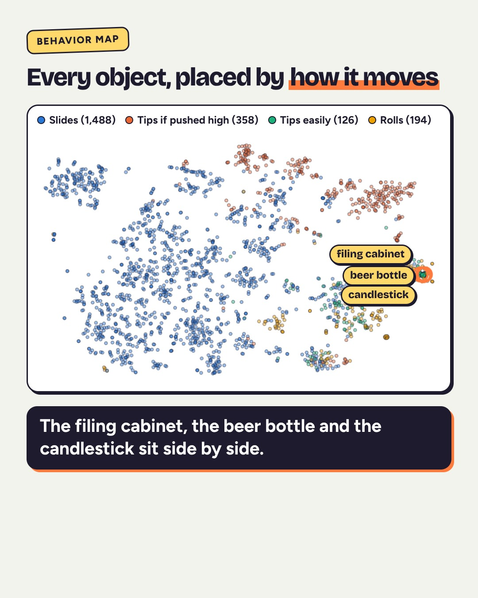

# Behaviors: search NVIDIA SimReady 3D assets by how they move

By Janelle Ghanem.

**Live demo: https://ghanemja.github.io/behaviors/**

[](media/behavior_search.mp4)

Every rigid asset in NVIDIA's SimReady library (2,166 objects) gets the same battery of simulated pokes: pushes,
a tilting ramp, drops. Each asset's reactions are summarized, either as simple statistics of the rollouts or as a
self-supervised JEPA embedding, and search returns the assets that reacted most alike, whatever they look like.
It is tested on probes no model saw, on assets never used during development, in MuJoCo and in NVIDIA's PhysX.

Everything runs on a CPU. `run_all.sh` regenerates every number from scratch.

## Data

- Source: [`nvidia/simready-assets`](https://huggingface.co/datasets/nvidia/simready-assets) on Hugging Face,
  2,576 assets. Every asset ships the same `LICENSE.txt`, Creative Commons Attribution 4.0 (checked per asset).
- Scope: rigid objects with at most 4 rigid parts (parts are frozen into one body). Articulated assets with more parts
  are left out, as are assets without a root USD file. Counts are in `data/v2/results/eval.json`.
- Physics values are read straight from the authored USD, following USD Physics precedence: mass properties authored on
  the rigid body override those derived from its colliders. SimReady ships three physics variants (MuJoCo, PhysX,
  Newton). They author identical mass, center of mass, inertia, friction and restitution (checked per asset); they
  differ only in collision approximation: convex hull (MuJoCo), SDF (PhysX), raw mesh (Newton).

## Probes

All probes are size-normalized (Froude scaling): push speed is 0.1·√(g·S) and rollout length is 30·√(S/g), clipped to
1.5-8 s, where S is the asset's largest dimension. A mug and a fridge are tested alike.

| Training probes (10) | Held-out probes (3), never seen by any embedding |
|---|---|
| bar push at 20%, 50%, 85% of height, along x and y | bar push at 65% height, diagonal, 1.4x speed |
| floor tilting slowly to 45°, about x and y | ramp tilting about the diagonal |
| drop from 0.5·S, tilted 25°, about x and y | drop from 1.0·S, tilted 45° about the diagonal |

Each training probe runs 3 times with small yaw and speed jitter (seeded per asset, reproducible).

The pusher is a bar, 2r thick and 2r tall (r = 3% of S) and 2S wide, centered on the object and moved across it, so it
meets whatever sticks out furthest at the probe height. Every push run records whether the bar touched the object;
the demo's descriptions count only runs where it did.

## Engines

- MuJoCo 3.17 with one convex hull per authored collision part, which is NVIDIA's MuJoCo variant.
- PhysX 5 (SAPIEN 3, CPU) with the identical hulls, to isolate the engine.
- PhysX 5 with SDF collision per part, which is NVIDIA's PhysX variant, on a fixed random sample of 600 assets.

Both engines receive the same hull polytopes (reduced to at most 128 vertices once, so neither engine re-simplifies),
the same mass properties and friction at both contacts. `src/sanity.py` checks both engines against textbook answers
(boxes that must slide or tip under a push, slip or tip on a ramp); both pass all cases.

## Evaluation protocol

Fixed before looking at test results:

- Development set: the 276 assets used while designing the model. Test set: every other simulated asset.
- Hyperparameters of the JEPA are frozen at the development values.
- Query: a test asset. Index: every simulated asset except the query, its product family (same name up to the
  `_a01`-style suffix) and recolored copies of the same mesh.
- Score: R² of the 5-nearest-neighbor mean prediction of 11 held-out outcomes (standardized), averaged over outcomes.
  95% intervals come from 2,000 bootstrap resamples of the queries; differences between methods are paired.
- Baselines: hand-built statistics of the same rollouts, static stability computed from geometry without simulation,
  physics metadata, SigLIP2 appearance (the model family behind NVIDIA's asset search), appearance plus metadata,
  words in the asset name, and random vectors.
- Cross-engine: the MuJoCo neighbors are also scored against PhysX outcomes.

## Results

Test set: 1,890 assets never used during development; 2,166 assets in the index. R² of the
5-nearest-neighbor prediction of the 11 held-out outcomes, with 95% bootstrap intervals.

| Method | MuJoCo outcomes | PhysX, same hulls (2,166 assets) | PhysX, SDF collision (498 sampled assets) |
|---|---|---|---|
| Simulation statistics (hand-built from the rollouts) | 0.53 [0.50, 0.55] | 0.40 [0.38, 0.42] | 0.33 [0.28, 0.37] |
| JEPA, self-supervised on the rollouts | 0.42 [0.40, 0.44] | 0.31 [0.28, 0.33] | 0.22 [0.17, 0.26] |
| JEPA trained on the 276 dev assets only | 0.45 [0.42, 0.47] | – | – |
| Static stability from geometry, no simulation | 0.33 [0.30, 0.36] | 0.31 [0.28, 0.34] | 0.28 [0.23, 0.32] |
| Physics metadata | 0.23 [0.20, 0.27] | 0.25 [0.23, 0.28] | 0.21 [0.15, 0.26] |
| Appearance + metadata | 0.17 [0.14, 0.20] | – | – |
| Appearance (SigLIP2 on NVIDIA thumbnails) | 0.16 [0.13, 0.19] | 0.17 [0.14, 0.19] | 0.10 [0.04, 0.15] |
| Words in the asset name | -0.09 [-0.12, -0.06] | -0.12 [-0.15, -0.09] | -0.19 [-0.25, -0.12] |
| Random vectors | -0.21 [-0.22, -0.19] | -0.19 [-0.21, -0.18] | -0.20 [-0.23, -0.17] |

- Simulated behavior beats appearance search by 0.36 R² (paired 95% interval 0.33 to 0.39),
  and the JEPA beats it by 0.26 (0.22 to 0.29). Behavior beats appearance in every engine setting.
- The JEPA trails the hand-built statistics by 0.11 (0.09 to 0.13). It generalizes: trained on the
  276 dev assets only, it scores slightly higher on the test assets (0.45 vs 0.42; paired difference 0.03, 0.02 to 0.04).
- Against PhysX with SDF collision, simulation statistics (0.33) and the no-simulation stability descriptor (0.28)
  have overlapping intervals. The advantage of simulating over computing static stability depends on the engine and
  collision model; search should use the engine you train in.
- Recolored duplicates matter: without excluding them, appearance search scores 0.37 instead of 0.16.
- For scale, an asset's own rerun with small yaw/speed jitter predicts its outcomes with R² ≈ 0.81.
- MuJoCo and PhysX (same hulls) agree on tip vs no tip in 86% of probe runs (90% away from the
  tipping point); 26% of runs end near the tipping point. With SDF collision: 80% (83%).

Full numbers: `data/v2/results/eval.json`.

## Data-quality findings

Over the 2,166 assets in the index (evidence per asset in `data/v2/results/qa.json`):

| Check | Assets | Kind |
|---|---|---|
| Center of mass authored at the mesh origin, which sits at the object's base | 16 | impossible as authored |
| Center of mass outside the convex hull of the collision geometry (by > 2% of size) | 12 | impossible as authored |
| Principal radius of gyration > 1.1x the farthest collision point | 82 | impossible as authored |
| Tips > 10° when released in the authored pose, in both MuJoCo and PhysX | 322 | many are wall-mounted fixtures |
| No friction authored | 99 | engines fall back to defaults |
| Mass / hull volume below 15 or above 25,000 kg/m³ | 98 | suspicious |

Also: 7 assets whose MuJoCo variant leaves out collider mass properties that the PhysX variant authors (a simulator
then computes them from geometry; the center of mass moves by up to 9% of the object's size), and some collision meshes are not watertight
(PhysX repairs them for SDF cooking and warns when repair fails).

## What changed after the first version (276 assets)

Hardening the first version found and fixed these problems in my own pipeline:

- Mass properties authored on the rigid body (about a fifth of all assets) were partly ignored: the body's mass was
  used but not its center of mass and inertia. Fixed to follow USD Physics precedence.
- One convex hull was wrapped around all collision parts; now one hull per authored part, as in NVIDIA's MuJoCo variant.
- The "height above floor" feature placed the hull at the center of mass instead of the body origin.
- Repeat jitter was seeded with Python's randomized `hash()`; now seeded with a stable CRC.
- The evaluation allowed recolored duplicates as neighbors and was scored on the development set. Now: frozen
  hyperparameters, a separate test set, duplicate and family exclusion, bootstrap intervals, more baselines, and a
  PhysX cross-check.
- The first version's claim that the JEPA matches hand-built statistics did not hold at full scale.

Later, at full scale:

- The pusher was a fingertip-sized sphere. On a narrow part (a bottle neck, a thin candle) a slightly off-center hit
  made it slide around the side, so an object that should topple counted as standing; MuJoCo's softer contact made
  this more common there than in PhysX. The pusher is now a bar spanning the object, every push run records whether
  it touched, and all simulations, embeddings and numbers were regenerated. MuJoCo and PhysX now agree on tip vs no
  tip in 92.0% of push runs (85.6% with the sphere); 8.4% of MuJoCo push runs changed outcome. Ramps and drops are
  unaffected (bit-identical). One asset whose drop was already numerically unstable now fails the stability check
  and is left out. In PhysX with SDF collision, the bar's high push destabilizes 9 sampled assets (box-on-SDF
  contact); they are left out of that column, which now covers 498 assets instead of 505.

## Repository layout

| Path | What it does |
|---|---|
| `run_all.sh` | rebuilds every number from scratch |
| `src/full_pipeline.py` | streams, converts and cleans up the dataset in batches |
| `src/convert.py` | USD to rigid-body record under a chosen physics variant |
| `src/sim.py` | probe battery in MuJoCo or PhysX |
| `src/sanity.py` | textbook physics tests for both engines |
| `src/train.py` | JEPA training and embeddings |
| `src/appearance.py` | SigLIP2 appearance embeddings |
| `src/evaluate.py` | the evaluation protocol above |
| `src/qa.py` | data-quality checks with evidence per asset |
| `src/analysis.py`, `src/export.py` | findings and the web demo data |
| `src/build_glb.py` | textured, decimated models for the demo |
| `src/build_pages.py` | assembles the GitHub Pages site |
| `src/video_models.py` | textured models for video objects the site does not ship (`video/models.txt`) |
| `out/site/index.html` | the demo page |
| `video/` | the 45-second captioned video: composition (`reel.html`), frame renderer (`render.js`) and soundtrack (`soundtrack.song.js`, every sound an equation, made with [equalizer](https://github.com/ghanemja/equalizer); its effects follow `cues.json`, the moments objects land or stay up) |
| `data/v2/results/` | `eval.json`, `qa.json`, `findings.json` and the embeddings |
| `src/legacy/` | scripts from the first, 276-asset version |

## Rebuild the demo and the video

```bash
python src/export.py --sim data/v2/sim_mj --assets data/v2/assets_mj --emb data/v2/results/emb.npz \
    --appearance data/v2/results/appearance.npz --findings data/v2/results/findings.json \
    --eval data/v2/results/eval.json --qa data/v2/results/qa.json --site out/site --method stats \
    --extra_sims data/v2/sim_px_parts data/v2/sim_px_sdf
python src/build_pages.py out/site pages_build https://ghanemja.github.io/behaviors/ https://github.com/ghanemja/behaviors
# video: serve video/ on port 8765, render frames with Playwright, encode with ffmpeg
mkdir -p video/mt && python src/reel_data.py out/site video && python src/video_models.py video/models.txt video
(cd video && python -m http.server 8765 &)
node video/render.js frames 30 && ffmpeg -framerate 30 -i frames/f%04d.jpg -c:v libx264 -pix_fmt yuv420p video.mp4
node video/render.js cues video/cues.json && node video/soundtrack.mjs soundtrack.wav && ffmpeg -i video.mp4 -i soundtrack.wav -c:v copy -c:a aac -b:a 192k -shortest \
    -movflags +faststart media/behavior_search.mp4
```

## Attribution

3D assets, thumbnails and authored physics values: [NVIDIA SimReady](https://huggingface.co/datasets/nvidia/simready-assets),
licensed [CC BY 4.0](https://creativecommons.org/licenses/by/4.0/). This project modifies them: meshes are simplified,
thumbnails are resized, and the physics is re-simulated. NVIDIA does not endorse this project.
